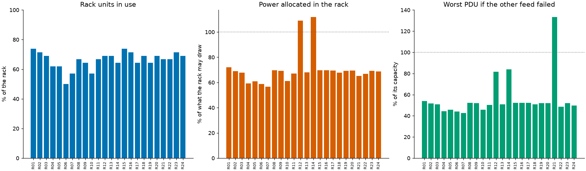
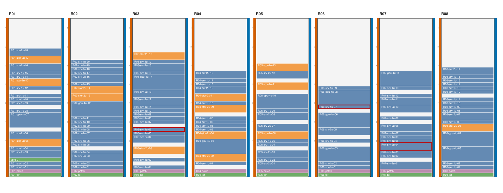

# dcim: a small DCIM in SQLite, with checks that are checked two ways

[](https://github.com/TexAlphaWolf/dc-dcim-lite/actions/workflows/ci.yml)
[](https://github.com/TexAlphaWolf/dc-dcim-lite/actions/workflows/codeql.yml)


A data center infrastructure manager small enough to read in an afternoon. It keeps **racks, devices, ports, cables and power
feeds** in one SQLite file (with a log of every change), and answers the questions that a spreadsheet cannot: **does anything
overlap or stick out of its rack, is every server on two different feeds, which cable is plugged in at one end only, and what would
the failure of feed A do to feed B?** It follows a cable **through patch panels**, draws **rack elevations as SVG** and exports a
static HTML page. The 12 consistency checks are verified twice: a second, deliberately literal implementation must give the same
answer on random broken data centers, and a generator that knows which faults it put in scores what the checks find. A command
line (`dcim`) with tests, a Docker image and reports generated from the numbers.



## What the numbers say

The demo data center ([`docs/report.json`](docs/report.json)) is 24 racks with 473 devices, 7,514 ports and 1,953 cables, generated
consistent and then given faults. **It is synthetic**: the faults are the ones the generator injects, so a detection score is a
ceiling and not an estimate of what you would find in a real data center. Speed figures are from one run in Docker on Linux x86_64
with 12 CPUs and Python 3.14.10 ([`docs/bench.json`](docs/bench.json); medians of 5 runs).

1. **The checks find all 600 faults injected into 50 data centers, and report nothing else.** Each data center (24 racks) is built
   consistent (50 of 50 had 0 findings before any fault went in), then 0 to 2 faults of each of the 12 kinds are injected at random
   places: 600 faults, 600 reported, 0 missed, 0 reports that are not an injected fault. This says the rules and the generator
   mean the same thing; it does not say the rules cover everything that goes wrong in a real room.
2. **Two implementations, one answer.** The indexed `check` and the literal `reference` give the same findings in the same order on
   51 comparisons (a generated data center and 50 random broken ones): 3,407 findings, all equal. The tests also push hand-computed
   cases through both, and show the comparison can fail.
3. **The demo has 12 faults and the checks report those 12.** One port with two cables, one cable plugged in at one end, two network
   cables on ports they do not suit, two servers without power, one on a single feed, two on two PDUs of the same feed, two racks
   allocated above their limit (R12 at 109%, R14 at 112%) and one PDU (R21-pduA) that could not carry its servers alone.
4. **Redundancy is a calculation, not a count of cables.** In normal operation each PDU of a rack carries about half of it and
   alone it would carry all of it. In the 12 racks of the demo with no injected fault that is 3.6 to 4.3 kW per PDU and 7.1 to
   8.6 kW alone, against 16 kW, so they are fine; the failover check finds the one PDU whose capacity (5,864 W) is below the 7,822 W
   it would carry alone.
5. **Speed.** Checking 307,349 devices (4.8 million ports, 1.3 million cables) takes 4.34 s; 10,249 take 88.9 ms. The cost per
   device doubles over a 300-fold growth (7.0 us to 14.1 us), so it is a little worse than linear.
6. **The indexed check is only 2.5 to 3.4 times faster than the literal one** (at 1,015 devices: 5.6 ms against 18.9 ms). The literal
   version is simple on purpose and, once it looks cables up in a table instead of scanning, it is nearly linear too. The indexed
   one is not much faster; the value of having both is the agreement, not the speed.
7. **SQLite is the slow part at scale.** Saving 102,684 devices takes 7.0 s and loading them 4.3 s (130.6 MB), against 1.29 s to check
   them. Everyday edits do not pay this: `add-device`, `move` and `connect` load the model and write one change.

[`docs/analysis.md`](docs/analysis.md) goes through the results; [`docs/method.md`](docs/method.md) defines every rule exactly;
[`docs/architecture.md`](docs/architecture.md) shows how the pieces fit; [`docs/report.md`](docs/report.md) and
[`docs/bench.md`](docs/bench.md) are the generated reports.



## Quick start

With Docker (nothing else to install):

```bash
docker build -t dcim .
docker volume create dcimv
docker run --rm --user 0 -v dcimv:/data --entrypoint chown dcim 10001 /data
RUN="docker run --rm --read-only --tmpfs /tmp --cap-drop ALL --security-opt no-new-privileges --network none -v dcimv:/data dcim"
$RUN generate /data/dc --racks 6 --seed 3                  # a synthetic data center and its truth
$RUN check /data/dc/dcim.db --truth /data/dc/truth.json    # exit code 1: there are findings
$RUN trace /data/dc/dcim.db R02-srv-2u-01:eth1             # follow a cable through the patch panel
```

With Python 3.11 to 3.14:

```bash
pip install .
dcim init my.db
dcim add-rack my.db A --units 42 --power-w 8000
dcim add-device my.db pduA --rack A --kind pdu --feed A --outlets 24 --capacity-w 4000
dcim add-device my.db srv1 --rack A --u 10 --height 2 --watts 600
dcim connect my.db srv1:psu0 pduA:out1
dcim check my.db                  # what is wrong, if anything (exit code 1 when there is something)
dcim elevation my.db -o racks.svg
dcim history my.db                # every change, with its time
```

## Real output

`dcim report` (the demo data center):

```text
demo data center (synthetic, 24 racks, seed 1, with injected faults): 24 racks, 473 devices, 7,514 ports, 1,953 cables
12 findings: 1 double_connected, 1 open_cable, 2 kind_mismatch, 2 no_power, 1 single_feed, 2 same_feed, 2 rack_power, 1 failover_overload
against the injected faults: 12 of 12 found, 0 reports that are not an injected fault
```

`dcim check` on `dcim generate dc --racks 6 --seed 3`:

```text
out_of_rack R02-gpu-4u-10: R02-gpu-4u-10 occupies units 40-43 of R02 (42 U)
open_cable cable:557: cable 557 is plugged in at R05-srv-1u-04:eth3 only
self_loop cable:556: cable 556 joins two ports of R04-srv-2u-02
self_loop cable:558: cable 558 joins two ports of R03-srv-1u-04
rack_power R06: R06 has 12844 W allocated of 12000 W
5 findings in 132 devices
against the injected faults: 5 of 5 found, 0 extra
```

`dcim trace dc/dcim.db R02-srv-2u-01:eth1` (through a patch panel to the core switch):

```text
cable 120: R02-srv-2u-01:eth1 -> R02-patch:1-front
cable 145: R02-patch:1-back -> core-01:19
ends at core-01:19
```

## The model

A **rack** has a number of units and the power it may draw. A **device** sits in a rack at a lowest unit with a height, has a kind
(`server`, `switch`, `storage`, `pdu`, `patch`, `other`) and a nameplate power; a PDU stands beside the units (unit 0, height 0),
belongs to feed `A` or `B` and has a capacity. A device has **ports** (network, power input, power output) and a **cable** joins
two ports, or one port and nothing (an open cable). Allocated power is 80% of the nameplate, in whole watts. Mistakes in geometry
and wiring are allowed in the model, because they are what the checks find; only a reference to a port or a rack that does not exist
is refused.

## Commands

| Command | What it does |
|---|---|
| `dcim init DB [--demo --racks N --seed S]` | Creates a database, empty or with a demo data center |
| `dcim generate DIR [--racks N --seed S --clean]` | Writes `dcim.db` and `truth.json`, a synthetic data center with injected faults (none with `--clean`) |
| `dcim import DB FACILITY INVENTORY` | Imports racks and installed devices from the files of [dc-capacity-planner](https://github.com/TexAlphaWolf/dc-capacity-planner) |
| `dcim add-rack`, `add-device`, `move`, `remove` | Edit the data center; a device that would overlap or not fit is refused unless `--force` |
| `dcim connect DEVICE:PORT [DEVICE:PORT]`, `disconnect ID` | Add or remove a cable (the kind is taken from the ports) |
| `dcim check DB [--truth FILE] [--limit N] [--all]` | Runs the 12 checks; exit code 1 if there are findings |
| `dcim trace DB DEVICE:PORT` | Follows the cable from a port, through patch panels |
| `dcim elevation DB -o FILE.svg [--rack R]`, `export DB -o FILE.html` | Rack elevations with the findings outlined; a static HTML page |
| `dcim history DB [--limit N]` | The log of changes |
| `dcim report [DB] [--truth FILE] [--out DIR]` | The report (the demo without a database): `report.json`, `report.md`, `summary.png`, `elevation.svg` |
| `dcim verify [--draws N] [--seed S]` | Compares the two implementations; exit code 1 on a difference |
| `dcim bench [--sizes ...] [--ref-sizes ...] [--repeat R] [--draws N] [--seeds N] [--out DIR]` | Speed, detection and agreement |
| `dcim render FILE.json [-o FILE.md] [--figure FILE.png]` | Rebuilds the Markdown (and figure) from a `report.json` or `bench.json` |

Exit codes: 0 success, 1 findings or a verification mismatch, 2 an error (a missing database, a bad port, an edit that is refused).

## The 12 checks

`overlap`, `out_of_rack`, `double_connected`, `open_cable`, `kind_mismatch`, `self_loop` (geometry and cabling); `no_power`,
`single_feed`, `same_feed` (redundancy); `rack_power`, `pdu_overload`, `failover_overload` (power budget). Each is defined in
[`docs/method.md`](docs/method.md).

## How it is checked

- [`reference.py`](src/dcimlite/reference.py) is the same 12 rules written as literally as possible: every pair of devices in a
  rack, every cable end looked up in a table. `dcim verify` compares it with the indexed [`check.py`](src/dcimlite/check.py) on a
  generated data center and on random broken ones. A finding is a rule and a subject; both must give the same list in the same
  order.
- The **generator** ([`generate.py`](src/dcimlite/generate.py)) builds a data center that is consistent by construction, then injects
  faults and writes down what it injected. `dcim check --truth` scores the findings against that list.

## Development

```bash
pip install -e ".[dev]"
ruff check . && ruff format --check . && mypy && pytest --cov
```

CI runs this on Python 3.11 to 3.14, again with more random draws and another seed, on Windows and macOS, builds the Docker image
and runs the end-to-end scripts (`tools/docker_e2e.sh`, and `tools/docker_e2e.ps1` from PowerShell). `tools/run_full.ps1`
produces the measurements in this README.

## Limits

The data centers are synthetic and the detection is scored on faults the same author injected. Cables are modelled as joining
ports, not as lengths or paths; a patch panel position is `N-front` and `N-back`; there is no airflow or cooling, no
asset lifecycle and no web interface. This is not NetBox. See [`docs/limitations.md`](docs/limitations.md).

MIT license.
